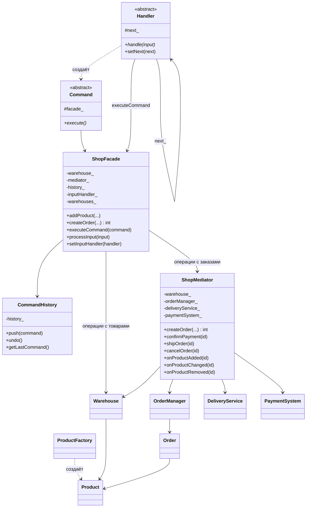
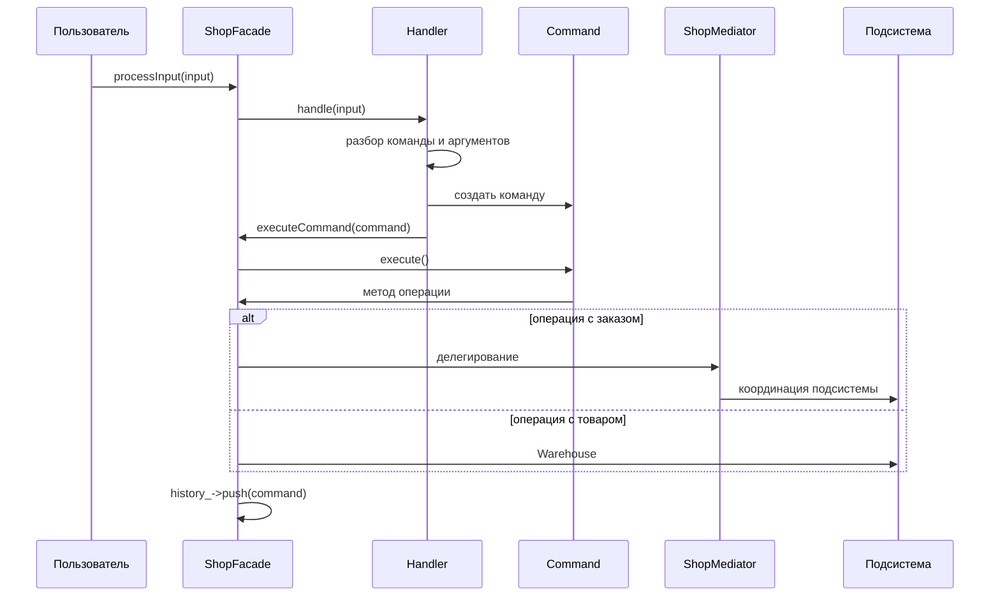

# Магазин с командами и цепочкой обработчиков на C++

Лабораторная работа по ООП: объединение системы складского учёта и системы управления заказами через паттерны «Команда», «Цепочка обязанностей», «Фасад» и «Посредник». В проекте также используются реализованные ранее «Стратегия», «Наблюдатель», «Прокси» и фабрика товаров.


## Содержание

1. [Цель и задача](#цель-и-задача)
2. [Структура проекта](#структура-проекта)
3. [Сборка и запуск](#сборка-и-запуск)
4. [Архитектура и UML](#архитектура-и-uml)
5. [Паттерн «Команда»](#паттерн-команда)
6. [Паттерн «Цепочка обязанностей»](#паттерн-цепочка-обязанностей)
7. [Паттерн «Фасад»](#паттерн-фасад)
8. [Паттерн «Посредник»](#паттерн-посредник)
9. [Ранее реализованные паттерны](#ранее-реализованные-паттерны)
10. [Ключевые проектные решения](#ключевые-проектные-решения)
11. [Демонстрационные сценарии](#демонстрационные-сценарии)
12. [Интерактивный режим](#интерактивный-режим)
13. [Тестирование](#тестирование)
14. [Соответствие требованиям](#соответствие-требованиям)
15. [Выводы](#выводы)

---

## Цель и задача

**Цель.** Объединить две предыдущие лабораторные работы в единое консольное приложение магазина, организовав ввод и выполнение операций через поведенческие и структурные паттерны.

**Что реализовано.**

| Компонент | Описание |
|---|---|
| `ShopFacade` | Единая точка входа для операций с товарами, заказами, командами и пользовательским вводом |
| `ShopMediator` | Координация склада, заказов, оплаты и доставки без прямых вызовов подсистем друг друга |
| `Command` и 12 конкретных команд | Операции добавления и изменения товаров, создания и обработки заказов, вывода данных |
| `CommandHistory` | Сохранение успешно выполненных команд, получение последней команды и удаление её из истории |
| `Handler` и 13 обработчиков | Разбор текстового ввода, создание команд и передача неподходящего ввода следующему обработчику |
| `Warehouse` | Хранение товаров, изменение цены и остатка, перемещение товара между складами |
| `OrderManager` | Создание заказов, смена статусов, статистика, проверка резервирования товаров |
| `DeliveryService` | Проверка и назначение доставки с учётом доступных ресурсов |
| `PaymentSystem` | Оплата и возврат средств |
| `main.cpp` | Пять демонстрационных сценариев и интерактивный режим |

---

## Структура проекта

```text
.
├── .vscode/
│   └── tasks.json                                  сборка всего проекта в magazik.exe
├── Attributes/                                     Price, Weight, Quantity
├── Command/
│   ├── Command.h / .cpp                            абстрактная команда
│   ├── CommandHistory/                             история выполненных команд
│   └── Commands/                                   12 конкретных команд
├── DeliveryService/
│   ├── Delivery/                                   интерфейс доставки
│   ├── DeliveryStrategies/                         курьер, самовывоз, почта
│   ├── DeliveryProxy/                              проверка доставки
│   └── DeliveryService.h / .cpp                    служба доставки
├── Discounts/                                      интерфейс и стратегии скидок
├── Handler/
│   ├── Handler.h / .cpp                            базовый обработчик и setNext
│   └── Handlers/                                   12 обработчиков команд и HelpHandler
├── ObserverPattern/                                Observable и Observer
├── Order/                                          заказ
├── OrderEvent/                                     событие смены статуса
├── OrderManager/                                   управление заказами и статистика
├── OrderStatus/                                    статусы и их текстовое представление
├── PaymentSystem/                                  оплата и возврат
├── Product/                                        товар
├── ProductFactory/                                 создание товаров
├── ShopFacade/                                     единая точка входа
├── ShopMediator/                                   координация подсистем
├── Warehouse/                                      склад
├── main.cpp                                        инициализация, сценарии, ввод
├── run.bat                                         запуск с кодировкой UTF-8
├── UML-diagram.md                                  диаграмма новых связей
└── README.md                                       этот отчёт
```

Каждый класс расположен в отдельном каталоге и разделён на `.h` и `.cpp`. Заголовочные файлы защищены `#pragma once`, пространство имён не импортируется глобально.

---

## Сборка и запуск

Проект использует C++17 и проверен с g++ 15 из MSYS2.

### Сборка в VS Code

В `.vscode/tasks.json` настроена задача **Build magazik.exe**. Она компилирует все 49 файлов `.cpp`, добавляет каталоги с заголовками через параметры `-I` и создаёт `magazik.exe` в корне проекта.

1. Открыть корневую папку проекта в VS Code.
2. Нажать **Ctrl + Shift + B**.
3. Дождаться создания `magazik.exe`.

Путь к компилятору указан как `C:\msys64\ucrt64\bin\g++.exe`. При другой установке MSYS2 необходимо изменить поле `command` в `tasks.json`.

### Запуск

В Windows программа запускается через `run.bat`:

```bat
@echo off
chcp 65001 > nul
magazik.exe
pause
```

Файл включает UTF-8, чтобы русские сообщения корректно отображались в консоли.

После запуска последовательно выполняются пять демонстрационных сценариев. Затем программа предлагает нажать Enter, очищает экран и переходит в интерактивный режим.

---

## Архитектура и UML

### Общая диаграмма



### Поток выполнения пользовательской команды



Команда попадает в историю только после успешного выполнения. Если при разборе или выполнении возникло исключение, интерактивный цикл выводит сообщение и продолжает работу.

---

## Паттерн «Команда»

**Идея.** Каждая операция представлена отдельным объектом. Команда хранит параметры вызова и ссылку на `ShopFacade`, а её метод `execute()` вызывает нужный метод фасада.

### Роли

| Роль | Классы |
|---|---|
| Абстрактная команда | `Command` |
| Конкретные команды | `AddProductCommand`, `CreateOrderCommand`, `ConfirmPaymentCommand` и остальные |
| Получатель | `ShopFacade` |
| Инициатор | Конкретный `Handler` |
| История | `CommandHistory` |

Базовый класс содержит `std::shared_ptr<ShopFacade> facade_`, виртуальный деструктор и чисто виртуальный `execute()`. Конструктор проверяет, что фасад существует.

Пример команды изменения цены:

```cpp
void ChangePriceCommand::execute(){
    facade_->changePrice(productId_, newPrice_);
}
```

Фасад выполняет и сохраняет команду:

```cpp
void ShopFacade::executeCommand(std::shared_ptr<Command> command){
    if(command == nullptr){
        throw std::invalid_argument("This Command does not exist");
    }
    command->execute();
    history_->push(command);
}
```

`CommandHistory::undo()` удаляет последнюю команду из истории, но не отменяет уже произведённую операцию: для обратных действий потребовался бы отдельный метод `unexecute()` или хранение предыдущего состояния.

---

## Паттерн «Цепочка обязанностей»

**Идея.** Каждый обработчик знает только один текстовый формат. Если ввод относится к другой команде, он передаётся по цепочке дальше.

Базовый `Handler` хранит `next_`. Метод `setNext()` связывает обработчики и возвращает следующий элемент, благодаря чему цепочка собирается последовательными вызовами.

Общая схема обработчика:

```cpp
if(action != "change" || subject != "price"){
    if(next_ != nullptr){
        return next_->handle(input);
    }
    return false;
}
```

После распознавания команды обработчик проверяет аргументы, создаёт объект команды и передаёт его в `ShopFacade::executeCommand()`.

В проекте 13 обработчиков: по одному на каждую из 12 команд и `HelpHandler`. Цепочка создаётся в `main()`. Фасад получает первый элемент через `setInputHandler()` уже после своего создания — это устраняет циклическую зависимость при инициализации, поскольку обработчикам также нужен фасад.

---

## Паттерн «Фасад»

**Идея.** Клиентский код и команды не обращаются напрямую к внутреннему устройству магазина. `ShopFacade` предоставляет единый интерфейс и только делегирует операции.

- Товарные операции направляются в `Warehouse`.
- Заказы, оплата и доставка направляются в `ShopMediator`.
- Выполнение команд дополняется записью в `CommandHistory`.
- Пользовательский ввод передаётся первому обработчику цепочки.

Фасад не содержит отдельной бизнес-логики заказов: резервирование, оплата, возврат товаров и смена статусов выполняются посредником и подсистемами.

Дополнительно фасад хранит реестр складов. Это позволяет выполнять команду `move product <id> to <warehouseId>`: целевой склад находится по идентификатору, после чего вызывается `Warehouse::moveProduct()`.

---

## Паттерн «Посредник»

**Идея.** `ShopMediator` координирует подсистемы, поэтому `Warehouse`, `OrderManager`, `DeliveryService` и `PaymentSystem` не хранят ссылки друг на друга и не вызывают друг друга напрямую.

### Создание заказа

1. Проверяется каждый товар.
2. Товар находится на складе, остаток уменьшается на единицу.
3. Создаётся заказ в `OrderManager`.
4. Товары добавляются в заказ.
5. `DeliveryService` назначает доставку.
6. Возвращается идентификатор заказа.

### Подтверждение оплаты

Посредник получает заказ, вызывает `PaymentSystem::processPayment()`, после успешной оплаты переводит заказ в `Paid` через `OrderManager`.

### Отмена заказа

Для `Pending` и `Paid` товары возвращаются на склад. Если заказ был оплачен, дополнительно выполняется возврат средств. Затем заказ переводится в `Cancelled`. Для остальных статусов выбрасывается исключение.

### События товаров

- `onProductAdded()` фиксирует добавление.
- `onProductChanged()` фиксирует изменение цены или остатка.
- `onProductRemoved()` вызывается до удаления и запрещает операцию, если товар зарезервирован активным заказом.

---

## Ранее реализованные паттерны

| Паттерн | Применение в объединённом проекте |
|---|---|
| «Стратегия» | `Delivery` и конкретные способы `CourierDelivery`, `PickupDelivery`, `PostDelivery`; также стратегии скидок |
| «Наблюдатель» | `Order` уведомляет `OrderManager` о смене статуса; менеджер обновляет оборот и число активных заказов |
| «Прокси» | `DeliveryProxy` проверяет регион и вес до делегирования вызова реальной доставке |
| Фабрика | `ProductFactory` создаёт товары с типизированными атрибутами `Price`, `Weight`, `Quantity` |

Эти компоненты не дублируют новую архитектуру: фасад и посредник используют их как внутренние подсистемы.

---

## Ключевые проектные решения

| Решение | Обоснование |
|---|---|
| `shared_ptr<Product>` | Один товар разделяется складом и заказами; изменение цены видно через все ссылки |
| `shared_ptr` для фасада, посредника и подсистем | Время жизни согласовано между командами, обработчиками и основными объектами |
| Цена и денежные суммы — `int` | Исключены ошибки округления при денежных расчётах |
| Вес — `double` | Поддерживаются дробные значения веса |
| Идентификаторы складов | Статический счётчик `Warehouse::nextId_` гарантирует уникальность внутри процесса |
| Проверка перед удалением товара | `OrderManager::isProductReserved()` просматривает заказы `Pending` и `Paid` |
| Исключения при ошибках | Некорректные аргументы и запрещённые переходы состояний не приводят к завершению программы |
| Сборка цепочки через сеттер | Сначала создаётся фасад, затем обработчики, после чего устанавливается первый элемент |

---

## Демонстрационные сценарии

Все сценарии выполняются автоматически при запуске и используют тот же `ShopFacade::processInput()`, что и интерактивный режим.

### Сценарий 1. Добавление товаров и просмотр склада

```text
add product Smartphone "iPhone 15" 100000 0.2 5
add product Laptop "MacBook Pro" 200000 2.0 3
show products
```

Результат: созданы товары с ID 1 и 2, склад выводит категорию, название, цену, вес и количество.

### Сценарий 2. Создание заказа с доставкой и оплатой

```text
create order "Иван" 1,2 courier
confirm payment 1
show orders
```

Результат:

```text
[OrderManager] INFO: заказ №1 оплачен, оборот = 300500
Id: 1 Клиент: Иван Статус: Paid Тип доставки: courier Регион доставки: RU Общая стоимость: 300500
```

Демонстрируются резервирование двух товаров, назначение курьерской доставки, оплата и обновление оборота через наблюдателя.

### Сценарий 3. Изменение цены и остатка

```text
change price 1 90000
change quantity 1 -2
show products
```

Результат: цена первого товара становится 90000, остаток уменьшается ещё на 2; каждое изменение сопровождается событием посредника.

### Сценарий 4. Отмена и отправка заказа

```text
create order "Пётр" 2 pickup
cancel order 2
ship order 1
show statistics
```

Результат:

```text
[OrderManager] INFO: заказ отменён, активных заказов: 1
Количество активных заказов: 1
Оборот: 300500
Количество клиентов: 2
Общее кол-во заказов: 2
```

Второй заказ создаётся и отменяется, его товар возвращается на склад. Первый оплаченный заказ переводится в `Shipped`.

### Сценарий 5. Координация через посредника

```text
add product Tablet "iPad" 80000 0.5 2
create order "Анна" 3 post
show products
show statistics
```

Результат: добавлен третий товар, при создании заказа его остаток уменьшается с 2 до 1. Статистика показывает 2 активных заказа, 3 клиентов и оборот 300500.

---

## Интерактивный режим

После демонстрационных сценариев пользователь нажимает Enter. Экран очищается, после чего доступны команды:

```text
add product <type> "<name>" <price> <weight> <quantity>
change price <id> <newPrice>
change quantity <id> <amount>
remove product <id>
move product <id> to <warehouseId>
show products
create order "<customer>" <productIds> <deliveryType>
cancel order <id>
confirm payment <id>
ship order <id>
show orders
show statistics
help
exit
```

После ввода команды предыдущее содержимое экрана очищается, а затем выводится результат операции или сообщение об ошибке. Под результатом отображается предложение снова вызвать `help` или завершить программу через `exit`.

---

## Тестирование

Проверка выполнялась запуском собранного `magazik.exe`: сначала прогонялись все автоматические сценарии, затем в интерактивном режиме подавались корректные и ошибочные команды.

| Область | Проверка | Результат |
|---|---|---|
| Сценарии | Все 5 сценариев выполнены последовательно | пройдено |
| Склад | Добавление, изменение цены и остатка, вывод товаров | пройдено |
| Заказ | Создание с двумя товарами, назначение доставки | пройдено |
| Оплата | Переход в `Paid`, оборот увеличился до 300500 | пройдено |
| Отмена | Переход в `Cancelled`, уменьшение числа активных заказов | пройдено |
| Отправка | Оплаченный заказ переведён в `Shipped` | пройдено |
| Резервирование | При создании заказа остаток уменьшается | пройдено |
| Защита товара | `remove product 3` отклонён: `Product is reserved` | пройдено |
| Несуществующий товар | `change price 999 10` выдаёт ошибку, цикл продолжается | пройдено |
| Несуществующий склад | `move product 1 to 999` выдаёт ошибку, цикл продолжается | пройдено |
| Справка | `help` выводит полный список команд | пройдено |
| Завершение | Все запуски завершились с кодом 0 | пройдено |

---

## Соответствие требованиям

| Требование | Где реализовано |
|---|---|
| Абстрактная команда и конкретные команды | `Command/`, `Command/Commands/` |
| История команд | `Command/CommandHistory/` |
| Выполнение команд через фасад | `ShopFacade::executeCommand()` |
| Абстрактный обработчик и цепочка | `Handler/`, `Handler/Handlers/` |
| Разбор пользовательского ввода | Методы `handle()` конкретных обработчиков |
| Единая точка входа | `ShopFacade` |
| Координация подсистем | `ShopMediator` |
| Отсутствие посредника внутри подсистем | Подсистемы получают только свои рабочие объекты |
| Пять демонстрационных сценариев | `main.cpp`, `runScenario()` |
| Интерактивный цикл | `main.cpp` |
| Тестирование сценариев и ошибок | Раздел «Тестирование» |

`LoggingProxy` в проект не добавлялся по указанию преподавателя.

---

## Выводы

- Две предыдущие лабораторные работы объединены в одно приложение с общим интерфейсом.
- «Команда» отделила параметры и выполнение операции от текстового ввода.
- «Цепочка обязанностей» позволила разделить разбор команд между независимыми обработчиками.
- «Фасад» стал единственной точкой входа для клиентского кода и команд.
- «Посредник» убрал прямые связи между складом, заказами, оплатой и доставкой.
- Ранее реализованные стратегии, наблюдатель и прокси сохранены и используются внутри новой архитектуры.
- Автоматические сценарии и ручные проверки подтвердили выполнение основных операций и устойчивость интерактивного цикла к ошибкам ввода.

**Известные ограничения и осознанные решения:**

- В команду добавления товара добавлен вес: `add product <type> "<name>" <price> <weight> <quantity>`. Это согласованное отступление от примера ТЗ, поскольку вес используется при проверке доставки.
- Регион при текстовом создании заказа устанавливается в `RU`; прокси и заказ получают одинаковое значение.
- `CommandHistory::undo()` удаляет запись из истории, но не откатывает состояние магазина.
- Основным складом для продаж остаётся первый склад; реестр дополнительных складов используется для перемещения товаров.
- Связь фасада и обработчиков через `shared_ptr` образует циклическую ссылку. В рамках консольного приложения объекты живут до завершения процесса; при дальнейшем развитии одну из связей следует заменить на `weak_ptr`.
